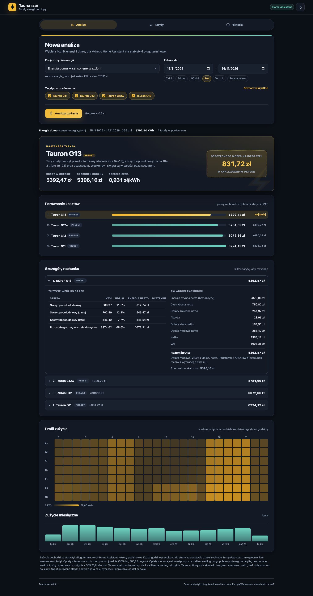

> **Disclaimer:** Aplikacja powstała przy użyciu AI i jak typowy AI-owy wysryw może zawierać błędy. Sprawdzaj wyniki, stawki i ustawienia przed podejmowaniem decyzji.

# Tauronizer

[](https://my.home-assistant.io/redirect/supervisor_add_addon_repository/?repository_url=https%3A%2F%2Fgithub.com%2Fdirek%2Ftauronizer)

**Porównywarka taryf energii elektrycznej Tauron dla Home Assistant.**

Tauronizer pobiera godzinowe zużycie energii ze statystyk długoterminowych
Home Assistant, przypisuje każdą godzinę do strefy wybranej taryfy i liczy
pełny rachunek: energię czynną, dystrybucję, opłaty stałe i zmienne, akcyzę
oraz VAT. Na tej podstawie pokazuje, która taryfa jest najtańsza dla Twojego
profilu zużycia — w wybranym okresie i w przeliczeniu na rok.

> **Stawki 2026:** presety dotyczą TAURON Sprzedaż (bez obszaru gliwickiego
> i ofert rynkowych) oraz TAURON Dystrybucja, ze stawką jakościową od 1 lutego.
> Wszystkie ceny konfiguracyjne są netto, energia bez akcyzy; VAT doliczamy
> do końcowej sumy netto. Sprawdź rodzaj umowy, liczbę faz i cykl rozliczeń.

## Przykładowa analiza



Zrzut przedstawia dane demonstracyjne, a nie rzeczywiste zużycie użytkownika.

## Nowości w 0.3.1

- Oznaczenie „Pozostałe godziny — strefa domyślna” w edytorze taryfy.
- Strefa domyślna zawsze jest sprawdzana na końcu, niezależnie od kolejności zapisanych stref.
- Zablokowany harmonogram strefy domyślnej i walidacja zapobiegająca dodaniu dwóch takich stref.
- Automatyczne rozpoznawanie strefy domyślnej w istniejących taryfach.

[Opis wydania 0.3.1](https://github.com/direk/tauronizer/releases/tag/v0.3.1)
· [Historia zmian](tauronizer/CHANGELOG.md)

## Funkcje

- **Gotowe presety Tauron:** G11, G12, G12w, G13 (z sezonowym szczytem
  popołudniowym w G13). Presety są edytowalne i można je przywrócić.
- **Własne taryfy:** dowolna liczba stref, dni tygodnia, przedziałów
  godzinowych i opcjonalnych ograniczeń miesięcznych (np. tylko zima).
- **Pełny rachunek:** energia, dystrybucja, opłaty stałe miesięczne, opłaty
  zmienne za kWh, akcyza i VAT.
- **Analiza historyczna:** wybór encji energii i zakresu dat (maks. 10 lat),
  porównanie kosztów, oszczędność względem najdroższej taryfy, szacunek roczny.
- **Szczegóły:** rozbicie kosztów, zużycie według stref, wykres miesięczny,
  mapa cieplna zużycia (dzień tygodnia × godzina).
- **Historia analiz:** do 200 zapisanych wyników w bazie dodatku.
- **Bez zewnętrznych zależności frontendu** — działa w panelu Home Assistant
  przez Ingress, także na telefonie. Motyw jasny i ciemny.

## Instalacja jako dodatek Home Assistant

Najszybciej: kliknij przycisk na górze README (albo poniżej) i zatwierdź
dodanie repozytorium w Home Assistant. Przycisk otwiera właściwe okno z
adresem repozytorium już wpisanym.

[](https://my.home-assistant.io/redirect/supervisor_add_addon_repository/?repository_url=https%3A%2F%2Fgithub.com%2Fdirek%2Ftauronizer)

Kroki ręczne:

1. W Home Assistant otwórz **Ustawienia → Dodatki → Sklep z dodatkami**.
2. Kliknij menu **⋮ → Repozytoria**, wklej
   `https://github.com/direk/tauronizer` i dodaj.
3. Odśwież sklep, znajdź **Tauronizer** i kliknij **Zainstaluj**.
4. Po instalacji uruchom dodatek. Panel **Tauronizer** pojawi się w menu
   bocznym Home Assistant.

Dodatek buduje obraz lokalnie na urządzeniu (nie wymaga gotowego obrazu w
rejestrze). Obsługiwane architektury: `amd64` i `aarch64`.

### Aktualizacja do 0.3.1

1. W sklepie dodatków odśwież repozytorium i otwórz **Tauronizer**.
2. Wykonaj kopię zapasową dodatku, a następnie wybierz **Aktualizuj**.
3. Po aktualizacji sprawdź stawki w zakładce **Taryfy**. Niezmienione presety
   zostaną odświeżone automatycznie. Edytowane presety i własne taryfy
   zachowują poprzednie wartości — uaktualnij je ręcznie lub wybierz
   **Przywróć presety**, aby zastąpić edycje presetów nowymi wartościami.
4. Sprawdź liczbę faz i cykl abonamentu. W sekcji opłaty mocowej wpisz pobór
   kwalifikujący z odczytu Taurona albo pozostaw pole puste dla szacunku.
   Usuń wcześniejszą opłatę mocową z opłat stałych lub zmiennych, jeżeli
   włączasz jej naliczanie w nowej sekcji.
5. Wykonaj nową analizę; zapisane wcześniej wyniki nie są przeliczane.

### Uprawnienia

- `homeassistant_api: true` — dostęp do REST API i WebSocket Home Assistant
  przez Supervisora. Token Supervisora jest dodawany automatycznie.
- `ingress: true` — panel działa w iframe Home Assistant; nie trzeba
  osobnego portu ani logowania.
- `panel_admin: false` — panel widzą także użytkownicy niebędący adminami.
  Oznacza to, że każdy, kto ma dostęp do panelu, widzi historię zużycia i
  może zmieniać taryfy. W razie potrzeby ustaw `panel_admin: true` w
  `config.yaml` i przebuduj dodatek.

## Jak korzystać

1. **Analiza** — wybierz encję energii (sensor z `device_class: energy` lub
   `state_class: total_increasing`), zakres dat i taryfy do porównania.
2. Kliknij **Analizuj zużycie**. Wynik pokaże najtańszą taryfę, koszt w
   okresie, szacunek roczny oraz rozbicie na strefy i składniki rachunku.
3. **Taryfy** — dostosuj stawki do swojej umowy. Możesz edytować preset
   (zmiany są lokalne), zduplikować go jako własną taryfę albo utworzyć
   nową. **Przywróć presety** cofa edycje presetów do wartości domyślnych.
4. **Historia** — podgląd i usuwanie zapisanych analiz.

### Strefy czasowe

Strefa pasuje, gdy spełnione są jednocześnie: miesiąc (jeśli podano), dzień
tygodnia, przedział godzinowy i wyjątek świąteczny. **Pierwsza pasująca
strefa wygrywa**, dlatego ostatnia strefa powinna pokrywać całą dobę.

- Godziny muszą być pełne, format `06:00-13:00`; doba to `00:00-24:00`.
- `months` (1–12) opcjonalnie ogranicza strefę do części roku — tak działa
  sezonowy szczyt w G13.
- „Święta traktuj jak pozaszczyt” wyłącza strefę w polskie dni ustawowo
  wolne (z Wielkanocą, Zielonymi Świątkami i Bożym Ciałem).
- Walidacja odrzuca taryfę, która nie pokrywa całego roku, wszystkich dni i
  godzin (z uwzględnieniem świąt).

### Wbudowane taryfy (2026, netto)

| Taryfa | Strefy | Uwagi |
| --- | --- | --- |
| G11 | jedna, cała doba | najprostsza |
| G12 | dzienna 06–13 i 15–22 | te same strefy we wszystkie dni, również weekendy i święta |
| G12w | szczyt: dni robocze 06–13 i 15–22 | weekendy i święta poza szczytem |
| G13 | przedpołudniowy 07–13; popołudniowy zimą 16–21 (X–III), latem 19–22 (IV–IX) | weekendy i święta poza szczytem |

### Stawki Tauron 2026

Zweryfikowano 14.11.2026. Energia w zł/kWh netto **bez akcyzy**;
kolumna „sieć” obejmuje wyłącznie składnik zmienny sieciowy.

| Taryfa / strefa | Energia | Sieć |
| --- | ---: | ---: |
| G11 cała doba | 0,4970 | 0,2464 |
| G12 dzienna | 0,5430 | 0,2841 |
| G12 nocna | 0,4130 | 0,0558 |
| G12w szczytowa | 0,6220 | 0,3298 |
| G12w pozaszczytowa | 0,4130 | 0,0512 |
| G13 przedpołudniowa | 0,4668 | 0,2203 |
| G13 popołudniowa (lato i zima) | 0,7780 | 0,3898 |
| G13 pozostałe godziny | 0,4210 | 0,0392 |

Dodatkowe stawki netto za kWh: jakościowa **0,0332** (od 01.02.2026;
w styczniu 0,0331), OZE **0,0073**, kogeneracyjna **0,0030**, akcyza **0,0050**.
Opłata przejściowa nie obowiązuje od 01.01.2026; usunięto ją z presetów.

Domyślne opłaty miesięczne netto: sieciowa **10,86 zł (3 fazy)**,
abonament **4,56 zł (cykl 1 miesiąc)**, handlowa **0 zł**.
Dla 1 fazy zmień sieciową na **7,38 zł**. Abonament przy cyklu
2/6/12 miesięcy to odpowiednio **2,28/0,76/0,38 zł za miesiąc**.
Dla oferty rynkowej wpisz opłatę handlową i ceny z własnej umowy.

**Opłata mocowa** dla gospodarstw domowych jest miesięczna, a nie za kWh:

| Pobór kwalifikujący | zł/miesiąc netto |
| --- | ---: |
| poniżej 500 kWh | 4,29 |
| 500–1200 kWh (włącznie) | 10,31 |
| powyżej 1200 do 2800 kWh (włącznie) | 17,18 |
| powyżej 2800 kWh | 24,05 |

W konfiguracji każdej taryfy można włączyć tę opłatę, zmienić cztery stawki
oraz wpisać pobór kwalifikujący. Tauron kwalifikuje według ostatnich 12 miesięcy
kończących się odczytem, a przy historii krótszej niż rok według poboru do
ostatniego odczytu (przed pierwszym odczytem najniższy próg — wpisz 0).
U prosumenta chodzi o pobór z sieci, nie całkowite zużycie domu ani eksport.
Puste pole oznacza **szacunek** z analizowanego okresu:
`kWh × 365,25 / liczba dni`; krótki okres i braki danych mogą zniekształcić próg.
Wynik pokazuje podstawę i wybraną stawkę. Jedna stawka obowiązuje w całej
symulacji oraz w szacunku rocznym; nie odtwarzamy zmian progu między odczytami.

Presety porównują profil historyczny według **jednego skonfigurowanego cennika**,
nie rekonstruują faktur ani zmian stawek w trakcie roku (w tym styczniowej jakościowej).
Wszystkie opłaty miesięczne, również mocową, szacujemy proporcjonalnie do dni;
faktura Taurona może inaczej rozliczać niepełne miesiące, zwłaszcza abonament.
Aktualizacja odświeża niezmienione presety; własne taryfy i edytowane presety
zachowują dotychczasowe wartości. Aby przejść na nowe stawki w edytowanych
presetach, użyj „Przywróć presety” lub zmień je ręcznie. Zapisane analizy pozostają
historycznymi wynikami — po aktualizacji wykonaj nową analizę.

Źródła:

- [Taryfa sprzedaży TAURON Sprzedaż 2026, URE nr 265/2025, pkt 1.6, 3.2 i 5](https://bip.ure.gov.pl/download/3/20340/TauronSprzedaz.pdf).
- [Wyciąg taryfy dystrybucyjnej 2026, grupy G, pkt 3.1.33–36 oraz 7](https://www.tauron-dystrybucja.pl/-/media/offer-documents/dystrybucja/aktualna-taryfa/wyciag-z-taryfy-td-sa-na-rok-2026-dla-odbiorcow-grup-g.ashx).
- [Zmiana stawki jakościowej od 1 lutego 2026](https://www.tauron-dystrybucja.pl/-/media/offer-documents/dystrybucja/aktualna-taryfa/nowa-stawka-oplaty-jakosciowej-od-1-lutego-2026r.ashx).
- [Zasady opłaty mocowej Taurona](https://www.tauron-dystrybucja.pl/rynek-mocy/oplata-mocowa).
- [Ministerstwo Energii: koniec opłaty przejściowej](https://www.gov.pl/web/energia/koniec-oplaty-przejsciowej-na-rachunkach-za-prad-od-2026-r).
- [Wigilia dniem ustawowo wolnym od 2025 r.](https://eli.gov.pl/api/acts/DU/2024/1965/text.html) — uwzględniona w kalendarzu G12w/G13.

## Metodologia i założenia

- **Dane:** godzinowe statystyki długoterminowe Home Assistant
  (`recorder/statistics_during_period`). Zużycie to pole `change`
  przeliczone na kWh (Wh, MWh, GWh, GJ, MJ, kJ, J).
- **Strefy:** przypisanie na podstawie czasu lokalnego `Europe/Warsaw`, z
  poprawną obsługą zmiany czasu (DST), weekendów i polskich świąt.
- **Opłaty stałe:** miesięczne opłaty netto rozliczane proporcjonalnie do
  liczby dni w analizowanym okresie (`dni × 12 / 365,25`).
- **Szacunek roczny:** koszty zmienne skalowane do 365,25 dnia + 12 opłat
  stałych i mocowych, następnie VAT.
- **VAT:** doliczany do sumy netto (domyślnie 23%). Akcyza i opłaty zmienne
  są liczone od każdej kWh.
- **Ujemne przyrosty** (np. reset licznika) są pomijane; aplikacja pokazuje
  ostrzeżenie. Podobnie ostrzega, gdy statystyki zaczynają się lub kończą
  wcześniej niż wybrany zakres.
- **Brak danych** w zakresie kończy się czytelnym komunikatem — sprawdź
  `state_class` encji i to, czy HA zbiera statystyki długoterminowe.

Wynik jest porównaniem taryf przy założeniu, że profil zużycia się nie
zmienia. Nie uwzględnia prognoz, zmian cen w czasie ani taryf dynamicznych.

## Prywatność i dane

- Dane są przechowywane lokalnie w katalogu dodatku `/data`
  (`tauronizer.db`, SQLite): taryfy, ustawienia i maks. 200 analiz.
- Dodatek komunikuje się wyłącznie z Home Assistant przez Sieć Supervisora.
  Nie wysyła danych na zewnątrz.
- Usunięcie dodatku usuwa też jego dane (katalog `/data` dodatku).

## Rozwój lokalny

Wymagania: Python 3.12+.

```bash
python -m venv .venv
# Windows: .venv\Scripts\activate
# Linux/macOS: source .venv/bin/activate
pip install -r tauronizer/requirements.txt
pip install pytest
```

Testy:

```bash
python -m pytest -q
```

Podgląd bez Home Assistant (deterministyczne dane demo, port 8099):

```bash
python tauronizer/scripts/preview.py
# http://127.0.0.1:8099
```

Baza podglądu trafia do `tauronizer/data-preview/` (ignorowana przez Git).
Aby wymusić czyste dane demo, usuń ten katalog przed uruchomieniem.

### Struktura projektu

```
repository.yaml          # repozytorium dodatków HA
tauronizer/
  config.yaml            # manifest dodatku (Ingress, uprawnienia)
  Dockerfile             # obraz Python 3.12 + uvicorn
  DOCS.md                # dokumentacja widoczna w panelu dodatku
  app/tauronizer/
    main.py              # FastAPI, trasy API, walidacja analizy
    tariffs.py           # presety, strefy, święta, DST
    calc.py              # silnik kosztów i agregacje
    ha_client.py         # REST + WebSocket Home Assistant
    db.py                # SQLite: taryfy, analizy, migracje presetów
    models.py            # modele Pydantic
    static/              # frontend bez frameworków
  scripts/preview.py     # lokalny serwer demo
  tests/                 # pytest
```

### Bezpieczeństwo

- Nagłówki bezpieczeństwa (`X-Content-Type-Options: nosniff`,
  `Referrer-Policy: no-referrer`, `X-Frame-Options: SAMEORIGIN`) są
  ustawiane w aplikacji.
- Token Home Assistant nie jest zapisywany w bazie ani zwracany przez API.
- API nie ma własnego logowania — ochrona pochodzi z Ingress Home Assistant.
  Nie wystawiaj portu 8099 bezpośrednio do Internetu.

## Licencja

Repozytorium jest publiczne, ale kod nie ma licencji open source — wszelkie
prawa zastrzeżone. Możesz zainstalować i używać dodatku na własnym Home
Assistant. Nazwa Tauron należy do jej właściciela; Tauronizer nie jest
powiązany z Tauronem.
